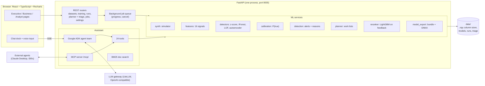

# Inventory Sentinel: inventory anomaly detection

Inventory Sentinel finds unusual stock movements in daily **store x SKU** records at **5 million rows** on a laptop.
It catches stock that goes missing, till behaviour that does not add up, miscounts, deliveries booked in wrong, typing
mistakes and items that stop selling while the system says they are in stock. It turns them into alerts with plain
reasons, shows trends by store and category, plans investigator time with an expected return, and learns from what
warehouse teams find.

It runs locally as one web app: a FastAPI + numpy / scikit-learn / LightGBM backend, a React + TypeScript UI, and an
optional AI assistant built on Google ADK that talks to any OpenAI-compatible LLM gateway (LiteLLM).

> **New here?** Go to [Quick start](#quick-start), then [Using the app](#using-the-app). For a screen-by-screen walk-through,
> demo scripts and troubleshooting, see **[GUIDE.md](GUIDE.md)**. To see how it works inside, read
> [Algorithms](#algorithms-how-detection-works), [Models used](#models-used) and [How AI helps](#how-ai-helps).

---

## Contents

1. [What it does](#what-it-does)
2. [Quick start](#quick-start)
3. [Using the app](#using-the-app)
4. [Architecture](#architecture)
5. [The data](#the-data)
6. [Algorithms: how detection works](#algorithms-how-detection-works)
7. [Models used](#models-used)
8. [How AI helps](#how-ai-helps)
9. [The AI assistant in detail](#the-ai-assistant-in-detail)
10. [Measured results](#measured-results)
11. [Using a model outside the app](#using-a-model-outside-the-app)
12. [Configuration](#configuration)
13. [API](#api)
14. [Testing](#testing)
15. [Project layout](#project-layout)
16. [What is in git and what is not](#what-is-in-git-and-what-is-not)
17. [Running on locked-down Windows](#running-on-locked-down-windows)
18. [Troubleshooting](#troubleshooting)

---

## What it does

| Area | Screens | What you get |
|---|---|---|
| **Executive** (default) | Overview · Alerts · Plan · Story | three headline numbers, where problems happen, the five alerts to work first, a stock-story drawer and an investigator-hours slider, all without statistics vocabulary |
| **Business** | 1 Data → 2 Train → 3 Act | generate or import daily records, let four methods compete, then alerts, a dashboard, an investigation planner, drill-downs and triage |
| **Analyst** | Models · Experiments | every metric, threshold, signal and run; model export as a Python bundle or ONNX |
| **Assistant** | chat on every page, Assistant page, Settings | a team of AI agents that reads alerts and plans, explains why something was flagged and proposes jobs for you to confirm |
| **How it works** | story + Present mode | a seven-slide leadership story with live figures |

The use case comes from the AI Friday brief, *anomaly detection in inventory*. An unsupervised model flags unusual
patterns (shrinkage, theft, counting errors), alerts warehouse teams, and a dashboard shows anomaly trends by store and
category. Inputs: daily inventory counts, warehouse transaction logs, historical loss-prevention flags, and store and
category details.

---

## Quick start

### Requirements

| Tool | Version | Why |
|---|---|---|
| Python | **3.11 to 3.14** | backend (the start scripts check this and rebuild `.venv` if needed) |
| Node.js | 18+ (LTS recommended) | builds the React UI |
| An LLM gateway | optional | only for the AI assistant; everything else runs offline |

No Docker and no database are needed.

### Start it

```bash
git clone <this repo> inventory_anomaly
cd inventory_anomaly
```

**Windows**: double-click `startup.bat`, or from a terminal:

```bash
startup.bat
```

**macOS / Linux:**

```bash
./start.sh
```

The script:

1. creates `.venv` with a supported Python
2. installs `requirements.txt`
3. runs `npm install` in `frontend/`
4. builds the UI into `frontend/dist`
5. starts the app at **http://127.0.0.1:8000** and opens your browser

The first run takes a few minutes. Later runs start in seconds.

| Option | Effect |
|---|---|
| `--port 8080` | serve on another port |
| `--no-browser` | do not open a browser tab |
| `--dev` | API with auto-reload on :8000 and the Vite dev server with hot reload on **:5173** |

Other launchers: `run_demo.ps1` (build the UI and serve it, Windows PowerShell) and `dev.ps1` (dev mode in two windows).

### Manual start (any OS)

```bash
python -m venv .venv
.venv/bin/python -m pip install -r requirements.txt
npm install --prefix frontend
npm run build --prefix frontend
.venv/bin/python -m uvicorn app.main:app --app-dir backend --host 127.0.0.1 --port 8000
```

(On Windows use `.venv\Scripts\python.exe`.)

### Start clean

Stop the app and delete the `data/` folder. It holds every dataset, model, run, triage decision and the assistant
settings, and it is recreated empty on the next start.

---

## Using the app

### Five-minute path

| Step | Where | Do | Takes |
|---|---|---|---|
| 1 | **Overview** (Executive) | press **Run the whole pipeline** on an empty install | ~1 min at 1M rows, ~4 min at 5M |
| or 1a | **1 Data** (Analyst) | **Generate** 80 stores x 500 SKUs x 125 days = 5M rows | ~30 s |
| 1b | **2 Train** | tick the four methods, press **Train**; the best becomes the *model in use* | ~1 min |
| 1c | **3 Act** | press **Run detection** | ~2 min |
| 2 | **Act → Alerts** | open the top critical alert: reasons, money at risk, P(true), stock story | |
| 3 | **Act → Investigation planner** | enter hours (e.g. 120) and hourly cost (e.g. £28) to get a ranked work list per team | instant |
| 4 | **Act → Triage** | **Simulate a week of team reviews**, then **Retrain with feedback** | ~40 s |
| 5 | **Chat** (bottom right) | "Why was the top alert flagged?" (needs a gateway, see below) | |

### Executive mode vs Analyst mode

The app opens in **Executive mode**:

- **Overview** shows money at risk, alerts worth a visit with their expected return, and how many times better machine
  learning ranks real problems than today's rule.
- **Where it happens** is a store x category heatmap.
- **Work these first** lists the planner's top five alerts.
- **Alerts**, **Plan** and **Story** complete the set.

The **Executive | Analyst** switch (top right) shows every screen. The browser remembers your choice.

### Each screen in one line

| Screen | What it is for |
|---|---|
| **1 Data** | Generate synthetic data or import a CSV / ZIP; preview daily rows, stores, SKUs, loss-prevention flags and (synthetic only) the answer key; export a ZIP |
| **2 Train** | Pick methods and settings; see the leaderboard, precision-recall curves and "what the winner catches" by anomaly type |
| **3 Act → Alerts** | Filter and sort alerts; open one for reasons, value at risk, P(true) and triage buttons; CSV download |
| **3 Act → Dashboard** | Trend by severity or type, store x category heatmap, top stores, teams and categories |
| **3 Act → Investigation planner** | Hours and cost in; ranked work list, expected recovery, return on cost, breakeven hours, per-team CSV / ZIP out |
| **3 Act → Drill-down** | One SKU in one store over time: expected against counted stock, daily gap, flagged days and why |
| **3 Act → Triage & feedback** | Record outcomes, simulate reviews, recalibrate P(true), retrain with a feedback re-ranker |
| **Models** | Every model with metrics, thresholds, drivers, calibration; export a bundle or ONNX |
| **Experiments** | Every training run with its leaderboard |
| **Assistant** | Full-page chat, saved conversations, per-agent token usage and cost |
| **Settings (⚙)** | LLM gateway URL, key, model, TLS options, single-agent or team mode, prices |

### Importing your own data

Upload a CSV with **one row per store, SKU and day**.

- **Required:** `date`, `store`, `sku`, counted closing stock, and either expected closing stock or opening + received + sold.
- **Recognised automatically:** common names such as `site`, `article`, `book_qty`, `soh_counted`, `receipts`, `voids`.
- **Optional columns that sharpen detection:** till scans, keyed-in scans, voids, overrides, after-hours scans, receiving
  scans, returns, promotion flag. A missing column switches off the signals that need it, with a note.
- **Optional ZIP with extra tables:** `stores.csv`, `skus.csv` (`category`, `unit_cost`) and `lp_flags.csv`.
- **Other column names:** map them with a JSON column map, for example `{"counted_closing": "physical_qty"}`.

### Connecting the AI assistant (optional)

1. Open **Settings (⚙)**.
2. Enter the gateway **URL** (e.g. `https://litellm.mycompany.net`) and **API key**, then press **Connect**.
3. Pick a model that supports **tool / function calling**, then press **Test** and **Save**.
4. Open the chat (bottom right on every page) and ask, for example:
   - "Show the top 10 critical alerts"
   - "Why was A000001 flagged?"
   - "Plan 120 investigator hours at £28 an hour"
   - "Did machine learning beat the rule of thumb?"

The key is stored server-side in `data/settings.json` (git-ignored) and is never sent back to the browser.

---

## Architecture



- **No database.** Each dataset is a folder of memory-mapped `.npy` columns (`colstore.py`), so 5M rows load instantly
  and stay off the heap. Models are `joblib` pipelines plus a JSON metadata file. Runs are `.npy` score arrays plus an
  incidents CSV. Triage decisions are append-only JSONL.
- **Long work runs as jobs.** Endpoints return `202` with a job id; the UI polls `/api/jobs/{id}` for steps, progress
  and estimated time, and can cancel.
- **The UI is served by the API.** In production mode FastAPI serves `frontend/dist`, so it is a single process on a
  single port.

---

## The data

### Synthetic generator (`services/synth.py`)

Each series (one SKU in one store) carries two stocks:

- a **physical stock** that the business cannot see
- a **book stock** that the system computes from deliveries, sales, returns, transfers and adjustments

Every evening the stock is counted (RFID-style) and the count resets the book. The daily gap
`expected_closing - counted_closing` is therefore the core shrinkage signal.

**Default size:** 80 stores x 500 SKUs x 125 days = **5,000,000 rows**. The allowed range is 1M to 10M rows.

- **Stores** span six regions across the UK and Ireland in four formats (high street, retail park, flagship, outlet),
  each with a warehouse team.
- **SKUs** fall into eight fashion and home categories, with realistic unit costs.

**Seven injected problem types**, each with its own fingerprint:

| Type | What happens | Fingerprint the models can see |
|---|---|---|
| External theft | stock goes missing for several days, more on high-risk items and hotspot stores | 7-day shrink well above count noise |
| Internal theft | 3 to 8 items go missing in one store on the same night | after-hours scans, store-wide shrink that day |
| Till / scan fraud | sweethearting (voids, overrides, keyed-in items) or refund fraud | till behaviour against the store's habit, returns |
| Counting error | a miscount that the next count reverses | today's gap reverses yesterday's |
| Receiving error | a delivery booked at a different quantity from what arrived | booked against scanned at receiving |
| Data-entry error | a quantity typed ten times too large, or with the wrong sign | delivery or adjustment many times the usual size |
| Sales pattern change | phantom stock (no sales while the books show stock) or an unexplained spike | sales against the promotion-adjusted normal, zero-sales runs |

**Hard negatives:** promotions, delivery-day noise, new lines, count noise that grows with stock and small background
shrink. They make a naive rule raise false alarms that the learned methods learn to ignore.

**Loss-prevention flags** are partial and noisy, as in real life:

- 40% of thefts and 20% of other problems are ever flagged
- 10% of flags carry the wrong type
- a few flags land on ordinary days

**The answer key** (`truth_type`, `truth_incident`, `truth_loss_units`) is stored separately. It is **never a model
input**; it is used only to mark the methods' homework and to simulate team reviews.

---

## Algorithms: how detection works

The pipeline end to end:

```
daily rows ──► 16 detection signals ──► 4 unsupervised detectors ──► score ──► percentile ──► severity
                                                                                  │
                                    P(true) calibration ◄─────────────────────────┤
                                                                                  ▼
      planner (expected £ per investigator hour) ◄── alerts (flagged days grouped) + reasons + likely type
                                                                                  │
            feedback re-ranker (LightGBM) ◄── team triage decisions ◄─────────────┘
```

### 1. Feature engineering: 16 "quiet on ordinary days" signals (`services/features.py`)

All features are computed with **segment-aware cumulative sums** over rows sorted by (store, SKU, date). This avoids a
pandas groupby and handles 5M rows in seconds. Trailing windows exclude the current day, so each day is compared with
its own recent past.

Each signal is scaled so that **ordinary days have light tails**, using Poisson or binomial z-scores against each
store's own habits, with variance normalised by the series' own count noise. This is the main reason the learned
methods beat the rule of thumb.

| Signal | Definition (simplified) | Catches |
|---|---|---|
| `shrinkage_pct` | (expected − counted) / expected x 100 | any loss |
| `variance_z_series` | (gap − 28-day mean gap) / max(28-day std, 0.35 + 2.5% of stock) | gaps beyond this item's own noise |
| `shrink_sum_7_z` | 7-day summed gap / count noise (miscounts cancel over a window; real loss does not) | slow, persistent theft |
| `shrink_pct_7` | 7-day gap / (7-day sales + stock) | persistent theft |
| `reversal_index` | √(−yesterday's gap x today's gap) / noise | miscounts reversed the next day |
| `velocity_z` | (sold − promotion-adjusted 28-day baseline) / √expected | sales spikes and drops |
| `zero_sales_streak` | run length x baseline daily sales (expected units missed) | phantom stock |
| `receiving_gap_units` | units booked − units scanned at receiving | receiving errors |
| `received_vs_typical` | delivery size / typical delivery for the item | data-entry errors (x10) |
| `adjustment_vs_typical` | adjustment size / 28-day typical | data-entry errors |
| `returns_z` | returns against the expected return rate | refund fraud |
| `manual_entry_z` | keyed-in scans vs the store's rate (binomial z) | sweethearting |
| `void_z` | voided lines vs the store's rate (Poisson z) | till fraud |
| `override_z` | price or quantity overrides vs the store's rate | till fraud |
| `after_hours_z` | scans outside opening hours vs the store's habit | internal theft |
| `store_day_shrink_z` | robust z of the store's total £ shrink that day vs its other days | internal theft (many SKUs at once) |

**Context features** describe the day but do not drive scoring. They are used for explanations and the drill-down:
units and £ variance, units sold, stock cover, delivery day, promotion, unit cost, day of week and category.

### 2. The four detectors (`services/detectors.py`, `services/registry.py`)

All four are **unsupervised**: they learn what a normal day looks like and need no labels. Each is a scikit-learn
`Pipeline` (a `pre` column step, then the `model`) with the same contract: `fit(X)` and `anomaly_score(X)`, where higher
means more unusual.

| Method | How it works | Input | Default settings | Score |
|---|---|---|---|---|
| **Rule of thumb** (robust z-score) *the baseline* | per category, the median and MAD (x 1.4826) of shrinkage % and gap units | 3 baseline columns | MAD floor 0.5 | max \|robust z\| of the two |
| **Isolation Forest** | random trees split the data at random thresholds; unusual days are isolated in few splits | 16 signals, unscaled | 150 trees, 2,048 rows per tree | 2^(−E[path length] / c(ψ)) |
| **Local Outlier Factor** | compares the density of a day's k-neighbourhood with its neighbours' densities (novelty mode against a reference sample of normal history) | 16 signals, standardised | k = 20, 4,000 reference rows | LOF ratio |
| **Autoencoder** | a small neural network (scikit-learn `MLPRegressor`) squeezes each day through a bottleneck and rebuilds it | 16 signals, standardised | layers 16-4-16, ReLU, L2 1e-4, batch 512, lr 1e-3, ≤ 60 epochs, early stopping | mean squared reconstruction error |

Every setting can be changed on the Train page. **Isolation Forest** and **LOF** fall back to built-in pure-numpy
implementations (`np_engines.py`) when scikit-learn's compiled modules are blocked (see
[locked-down Windows](#running-on-locked-down-windows)). They are the same algorithms from the original papers and rank
rows the same way.

### 3. Training protocol (`services/training.py`)

1. **Split by time.** The first 72% of days are history; the **last 28% are the exam**, which is never seen in training.
2. **Sample.** Fit on 200,000 random history rows (100,000 in quick mode). Days with loss-prevention flags are excluded
   by default, so the models learn "normal".
3. **Set thresholds** from the distribution of training scores (about 260 quantile levels, dense in the tail):
   - **alert** = the (1 − alert rate) quantile; the default alert rate is 0.8%, so the 99.2nd percentile
   - **high** = the 99.8th percentile
   - **critical** = the 99.95th percentile
4. **Mark the exam.** Use every positive in the exam window plus 300,000 sampled negatives, weighted so they stand for
   all negatives. Labels come from the synthetic answer key; on real data they come from loss-prevention flags, a lower
   bound because most incidents are never flagged. With no labels, only the alert rate is reported.
5. **Pick the winner.** The method with the highest **average precision** becomes the *model in use*.

| Metric | Meaning |
|---|---|
| **Average precision** (decides the winner) | how well the ranking puts real problems first; 1.0 is perfect, random equals the base rate |
| **Real in the top 1,000** (precision@1000) | of the 1,000 most unusual exam days, how many were real |
| **Incidents caught** | share of hidden incidents with at least one flagged day |
| **Value caught** | share of the £ lost in hidden incidents that falls on flagged days |
| **Detection by type** | incidents caught per anomaly type |
| ROC-AUC, LP recall | also reported, for analysts |

**Drivers** (feature importance) are the mean robust deviation of each signal on flagged exam days, normalised to sum
to 1. This works the same way for every method, including the ones without built-in importances.

### 4. P(true): calibrating scores into probabilities (`services/calibration.py`)

A score percentile is not a probability, so each model learns **P(real problem | score percentile)**:

- 16 bins above the alert threshold, spaced geometrically so they get denser towards the top
- the rate of real problems in each bin, smoothed with a **Beta(1, 1) prior** (Laplace smoothing)
- made monotone (a higher score never means a lower probability) with **weighted pool-adjacent-violators** isotonic
  regression, implemented in pure numpy

Before any labels exist, a stated prior is used: 15% of alerts at the threshold are real, rising to 60% at the very top.
**Recalibrate P(true)** on the Triage tab refits the curve from team decisions.

### 5. From flagged days to alerts (`services/detection.py`, `services/explain.py`)

Detection scores every row in 250k-row chunks, maps scores to percentiles, and marks medium, high or critical severity.
Then:

- **Grouping.** Flagged days of the same SKU in the same store become one **alert (incident)**. A single quiet day
  between flagged days is bridged.
- **Value at risk** = Σ max(gap, 0) x unit cost over the alert's days.
- **Peak day** = the day with the highest score. Its signals drive the reasons and the type guess.
- **Reasons.** Each signal's robust deviation from the training baseline for that **category** (median, MAD, 99th
  percentile) is ranked. The top three with deviation ≥ 2 become plain sentences, such as *"Delivery booked as 240 units
  but 24 were scanned in"*. Three variants of the same shrinkage story are collapsed into one.
- **Likely type.** Ordered rules over the peak day, each with a confidence:

  | Order | Rule | Likely type |
  |---|---|---|
  | 1 | delivery or adjustment about 5x or more its typical size | data-entry error |
  | 2 | reversal ≥ 3, or a short net-zero swing | counting error |
  | 3 | delivery day with a booked-vs-scanned gap | receiving error |
  | 4 | voids, overrides, keyed-in items or returns z ≥ 3 | till / scan fraud |
  | 5 | after-hours scans or store-wide shrink z ≥ 3 | internal theft |
  | 6 | big sales shift or zero-sales run with little net loss | sales pattern change |
  | 7 | 7-day shrink z ≥ 3, or sustained net loss | external theft |
  | 8 | otherwise | unclear |

- **P(true)** for each alert comes from the calibration curve at its peak percentile.

### 6. Investigation planner (`services/planner.py`)

The planner turns investigator hours into a ranked work list. For each open alert *i*:

```
cash_i  = value_at_risk_i x cash_share(type_i)          # book-keeping errors are corrected, not recovered as money
V_i     = cash_i x recovery_rate                         # recovered now (default 40%)
        + cash_i x persist(type_i) x horizon_days / 28   # similar loss prevented from recurring
EV_i    = P(true)_i x V_i                                # expected value
cost_i  = minutes(type_i) / 60 x hourly_cost             # e.g. theft 60-90 min, data-entry error 10 min
```

Alerts are sorted by **EV per investigator hour** and taken greedily until the hours run out. The planner reports:

- expected recovery, cost and return on cost
- **breakeven hours**: the point where the next alert returns less than it costs
- a curve of what more hours would buy
- a comparison against the naive approach of working down by raw £ at risk

Work lists come out as one CSV per warehouse team. All figures are **estimates** that depend on the recovery rate and
on P(true).

### 7. Learning from feedback (`services/triage.py`, `services/reranker.py`)

Teams record one of four outcomes per alert: **confirmed theft, counting error, process issue or false alarm**.
Decisions are stored per dataset under a stable alert key, so they carry across detection runs. On synthetic data,
**Simulate a week of team reviews** fills in decisions from the answer key, with noise. Teams work the top of the queue
and spot-check further down.

**Retrain with feedback** becomes available after 30 reviews with at least 5 real problems and 5 false alarms. It trains
a supervised **re-ranker** on top of the unsupervised detector:

- **Features:** all 25 features plus the base detector's percentile.
- **Labels and weights:**
  - confirmed alert days: positive, weight 1
  - historical loss-prevention-flagged days: positive, weight 0.7
  - false alarms: negative, weight 1
  - 20,000 unlabelled days: negative, weight 0.2
- **Classifier:** **LightGBM** (200 trees, 15 leaves, learning rate 0.05, row and column subsampling 0.8). It falls back
  to logistic regression if LightGBM cannot load.
- **Score:** `α x base percentile + (1 − α) x P(real)`, with α = 0.4 by default.
- **Judged honestly:** only on exam days that **nobody reviewed**, shown as a before/after table, so it cannot win by
  memorising the labels it was given.

---

## Models used

### Machine-learning models (run locally, inside the app)

| Model | Library | Kind | Role |
|---|---|---|---|
| Robust z-score rule | numpy | statistical rule | baseline, today's typical shrinkage rule |
| Isolation Forest | scikit-learn `IsolationForest` (or built-in numpy engine) | unsupervised tree ensemble | usually the winner |
| Local Outlier Factor | scikit-learn `LocalOutlierFactor` (or built-in numpy engine) | unsupervised density / neighbours | competitor |
| Autoencoder | scikit-learn `MLPRegressor` | unsupervised neural network | competitor |
| Feedback re-ranker | **LightGBM** `LGBMClassifier` (fallback: scikit-learn `LogisticRegression`) | supervised gradient boosting | learns from team decisions |
| P(true) calibration | numpy (Beta prior + isotonic PAV) | probability calibration | turns scores into "8 in 10 alerts like this are real" |
| Exported models | `onnx` graph + `onnxruntime` validation | inference format | use the model outside Python |

All of these train on your machine, on your data. Nothing is sent anywhere.

### Language model (optional, for the assistant only)

| Item | Detail |
|---|---|
| Provider | **any** OpenAI-compatible gateway, typically a [LiteLLM](https://docs.litellm.ai/) proxy; you choose it in Settings |
| Model | whichever model you pick from the gateway's list; it **must support tool / function calling** (e.g. a Claude, GPT or Gemini model exposed by the gateway). No model is bundled or hard-coded |
| How it is called | Google ADK `LiteLlm` adapter → `openai/<model>` at `<gateway>/v1`, temperature 0.2, 120 s timeout |
| Agent framework | **Google ADK** (`google-adk`): `LlmAgent` tree, `Runner`, `DatabaseSessionService` (SQLite) |
| Docs search | **BM25** over README, GUIDE and the story (no embeddings, no vector DB) |
| Voice input | the browser's built-in Web Speech API (speech-to-text happens in the browser) |

---

## How AI helps

There are two kinds of AI in Inventory Sentinel, and they do different jobs.

### 1. Machine learning finds the problems

| Without it (today's rule) | With it |
|---|---|
| A fixed shrinkage threshold flags any big one-day gap, including promotions, delivery-day noise and miscounts that reverse the next day | Signals are scaled to each item's and store's own normal, so ordinary noise stays quiet |
| It only sees shrinkage | It combines 16 signals: till behaviour, receiving scans, after-hours activity, sales velocity, store-wide patterns |
| It misses till fraud and internal theft, which never show up as one big gap | Isolation Forest catches almost all till fraud and internal theft |
| It ranks real problems poorly | **1.7x the average precision**; **986 of the top 1,000** exam days are real problems vs 426 for the rule |
| Every alert looks equally urgent | Each alert carries money at risk, a likely type, plain reasons and P(true) |
| Investigator time goes to the biggest £ figure | The planner spends hours where **expected recovery per hour** is highest |
| The rule never improves | Team decisions train a re-ranker, judged on days nobody reviewed |

The learned methods need **no labels**. They learn what normal looks like, which matters because real
loss-prevention flags cover only a fraction of incidents.

### 2. A language model makes the results easy to use

The assistant is a team of agents that lets anyone, from a store manager to a CIO, ask questions in plain English
instead of learning the screens:

- **Answers from live data.** "Why was A000123 flagged?", "Which stores lose most in beauty?", "What does 120 hours
  buy us?". Every number comes from a tool call against the app; the assistant is told never to invent figures.
- **Knows what you are looking at.** "Why was *this* flagged?" works on the alert open on screen.
- **Explains the maths.** "What does average precision mean?", "Why did Isolation Forest win?" (glossary plus BM25 doc
  search over this README and the guide).
- **Drafts actions, you decide.** "Train all four methods" or "run detection" become a **proposal card** you confirm.
  The assistant never runs or changes anything by itself.
- **Speaks the audience's language.** In Executive mode it answers in under 90 words without statistics jargon.
- **Responsible by design.** It describes patterns as "consistent with" theft or error, never accuses a person or team
  (the data holds no employee identities), and labels figures that come from the synthetic answer key.
- **Open to other agents.** The same 24 tools are an **MCP server**, so Claude Desktop, IDE agents or other apps can
  query alerts and plans directly.

**What the LLM does not do:** it does not score rows, choose alerts, set thresholds or compute money figures. All of
that is deterministic, reproducible ML and arithmetic in the backend. The LLM only reads tool results and explains them.

---

## The AI assistant in detail

### Agent team (`assistant/agents.py`)

A **front-door agent** answers quick questions itself and hands deeper ones to a specialist (Google ADK `sub_agents`
with transfer):

| Agent | Handles | Tools |
|---|---|---|
| **Front door** (`sentinel_assistant`) | greetings, "what is loaded", status, routing | common: `app_state`, `search_docs`, `explain_metric`, `job_status`, `usage_summary` |
| **Data analyst** | datasets, columns, the generator, LP flags; proposes generate / import | common + `list_datasets`, `describe_dataset`, `preview_rows`, `propose_job` |
| **Model analyst** | methods, metrics, drivers, training, feedback retraining, ONNX, model in use | common + `available_algorithms`, `list_models`, `model_detail`, `list_experiments`, `triage_summary`, `list_datasets`, `propose_job` |
| **Alert investigator** | runs, alerts, why something was flagged, drill-downs, trends, hotspots | common + `list_detection_runs`, `alert_summary`, `list_alerts`, `explain_alert`, `sku_drilldown`, `anomaly_trend`, `hotspots`, `search_series`, `propose_job` |
| **Loss-prevention planner** | investigator hours, expected recovery, ROI, work lists | common + `list_detection_runs`, `alert_summary`, `investigation_plan`, `compare_plans`, `hotspots` |
| **Explainer** | how the app works, glossary, screens, troubleshooting | common |

Settings can switch to **single-agent mode**: one agent with every tool, which is cheaper on small models.

### What each agent sees

Every agent's instruction is rebuilt on each turn from three parts:

1. **Preamble:** what the app is and its conventions (British English, £, plain metric wording).
2. **Guardrails:** ten rules, summarised below.
3. **Current state** (`context_pack.py`): the page, tab and mode you are on, the selected dataset, run, alert and
   store/SKU, the model in use, running jobs and pending proposals.

Tool arguments such as `run_id`, `alert_id` and `store_id` are filled from the UI selection when the model leaves them
empty (`adk_tools.py`). Tool results are capped at 20 rows and 600-character texts to keep prompts small.

**Guardrails (summary):**

- never invent numbers
- one well-chosen tool call, then answer
- every change is a proposal for you to confirm
- planner figures are estimates
- uploads, deletes and triage happen in the app's pages, not in chat
- say which model produced a run
- "consistent with", never accusations
- name figures that come from the synthetic answer key
- executive answers stay short and jargon-free

### The 24 tools (`assistant/tools.py`)

| Group | Tools |
|---|---|
| Data | `list_datasets`, `describe_dataset`, `preview_rows` |
| Models | `available_algorithms`, `list_models`, `model_detail`, `list_experiments` |
| Alerts | `list_detection_runs`, `alert_summary`, `anomaly_trend`, `hotspots`, `list_alerts`, `explain_alert`, `sku_drilldown`, `search_series` |
| Planning | `investigation_plan`, `compare_plans`, `triage_summary` |
| Jobs | `propose_job`, `job_status` |
| Help | `search_docs`, `explain_metric`, `app_state`, `usage_summary` |

### Proposals, not actions (`assistant/proposals.py`)

There are eight proposal kinds:

- `generate`
- `configure`
- `train`
- `detect`
- `retrain_feedback`
- `export_dataset`
- `export_onnx`
- `activate_model`

The assistant validates the parameters, estimates the run time and shows a card. Nothing runs until you press
**Confirm**; then the job goes through the normal job queue. Proposals expire after 30 minutes.

### Transparency and cost (`assistant/usage.py`)

- **Thinking trail.** Every answer shows hand-overs between agents, tool calls with timings, and the tokens and cost
  of that answer.
- **Usage page.** The Assistant page breaks usage down by agent and by day.
- **Prices.** Prices come from your Settings override, then the gateway's own price list, then LiteLLM's bundled price
  map; otherwise cost shows as "n/a".
- **Limits.** Each turn is capped at 24 LLM calls and a 120 s timeout.
- **Saved conversations.** Conversations are kept in `data/assistant.sqlite`.

### What leaves your machine

Only when a gateway is configured, and only to that gateway:

- the conversation
- the current-state summary
- tool results: aggregates and at most 20 rows per call

Raw datasets, models and the answer key are never uploaded. Without a gateway, nothing leaves the machine.

### MCP server for external agents (`assistant/mcp_server.py`)

`http://127.0.0.1:8000/mcp/` exposes the 24 tools over streamable HTTP, plus four resources: `sentinel://guide`,
`sentinel://readme`, `sentinel://glossary` and `sentinel://story`. Point any MCP client at that URL. Jobs proposed over
MCP still need confirmation in the app's chat.

---

## Measured results

These figures were measured on 5,000,000 store-SKU-days on a 6-core laptop. Four methods were trained on a
200,000-day sample of the history window and marked on the last 28% of days (the exam) against the synthetic answer key.

| Method | Average precision | Real in the top 1,000 | Incidents caught | Value caught |
|---|---|---|---|---|
| Rule of thumb (baseline) | 0.25 | 426 | 61% | 50% |
| **Isolation Forest** (winner) | **0.42** (1.7x) | **986** | 55% | **59%** |
| Local Outlier Factor | 0.32 | 583 | 55% | 57% |
| Autoencoder | 0.20 | 374 | 50% | 40% |

- The rule of thumb catches big one-day gaps (miscounts, typing errors) but misses patterns spread across signals.
  Isolation Forest finds almost all till fraud and internal theft, which never show up as one big shrinkage day.
- After a simulated week of team reviews, the **feedback re-ranker** improves on days nobody reviewed (Triage tab).

| Step | Time |
|---|---|
| Generate 5M rows (simulation, features, stats) | ~29 s |
| Train all four methods | ~58 s |
| Detect with Isolation Forest (numpy engine) | ~2 min |
| ONNX export + validation, per model | < 1 s |

---

## Using a model outside the app

On **Models**, open **Use this model elsewhere**.

The **model bundle (.zip)** contains:

- `model.joblib` and `model.json`
- `features.py`, `detectors.py` and `np_engines.py`
- `predict.py`
- pinned `requirements.txt`

Score a file with:

```bash
python predict.py daily.csv scored.csv --skus skus.csv
```

This adds `anomaly_score`, `percentile`, `severity` and `is_alert` to every row.

**ONNX:**

- one float32 input `features` and one output `anomaly_score`
- built directly with the `onnx` package (no skl2onnx)
- validated with onnxruntime to rank 2,000 sample days exactly like the Python model
- runs from C#, Java, JavaScript or anything else with onnxruntime

The feedback re-ranker chains two models, so it is bundle-only.

---

## Configuration

### Environment variables

| Variable | Default | Purpose |
|---|---|---|
| `SENTINEL_DATA_DIR` | `./data` | where datasets, models, runs and settings live |
| `SENTINEL_MIN_ROWS` | `1000000` | minimum dataset size; lower it (e.g. `50000`) for quick tests |
| `LITELLM_SSL_VERIFY` | unset (off) | `true` verifies the gateway's TLS certificate |
| `LITELLM_CA_BUNDLE` / `SSL_CERT_FILE` / `REQUESTS_CA_BUNDLE` | unset | PEM bundle for a corporate CA |
| `LITELLM_LOCAL_MODEL_COST_MAP`, `LITELLM_TELEMETRY`, `ADK_DISABLE_TELEMETRY` | set by the start scripts | offline price map, telemetry off |

### Tunables (`backend/app/config.py`)

| Setting | Default | Meaning |
|---|---|---|
| `DEFAULT_STORES / SKUS / DAYS` | 80 / 500 / 125 | generator size (5M rows) |
| `MIN_ROWS / MAX_ROWS` | 1M / 10M | allowed dataset size |
| `DEFAULT_TRAIN_SAMPLE` | 200,000 | rows used to fit each method |
| `DEFAULT_ALERT_RATE` | 0.008 | share of training days above the alert threshold |
| `SEVERITY_QUANTILES` | high 0.998, critical 0.9995 | severity cut-offs |
| `TEST_WINDOW_SHARE` | 0.28 | last share of days held out as the exam |
| `PLANNER_DEFAULTS` | 120 h, £28/h, 40% recovery, 28-day horizon | planner inputs |
| `MINUTES_BY_TYPE`, `PERSIST_BY_TYPE`, `CASH_SHARE_BY_TYPE` | per anomaly type | planner assumptions |
| `RETRAIN_MIN_REVIEWED / _EACH` | 30 / 5 | feedback needed before retraining |
| `ASSISTANT_MAX_LLM_CALLS`, `ASSISTANT_TIMEOUT_S` | 24, 120 | assistant limits |

---

## API

Interactive docs are at **http://127.0.0.1:8000/docs**. Heavy endpoints return `202` with a job; poll
`GET /api/jobs/{id}`.

| Method | Path | Purpose |
|---|---|---|
| GET | `/api/health`, `/api/config`, `/api/overview` | versions and engines, limits, summary |
| POST / GET | `/api/datasets/generate`, `/upload`, `/{id}/configure`, `/{id}/preview?table=`, `/{id}/export` | data |
| GET / POST | `/api/models/available`, `/api/train`, `/api/models`, `/api/models/{id}/activate`, `/api/experiments` | training |
| POST / GET | `/api/detect`, `/api/runs`, `/api/runs/{id}/dashboard`, `/alerts`, `/alerts/{alert_id}`, `/series`, `/search` | detection |
| POST / GET | `/api/plan`, `/api/plan/{run_id}/worklist.csv`, `/worklist.zip` | investigation planner |
| POST / GET | `/api/triage`, `/triage/bulk`, `/triage/summary`, `/triage/simulate`, `/api/runs/{id}/recalibrate`, `/api/models/{id}/retrain-feedback` | feedback |
| GET / POST | `/api/models/{id}/export`, `/api/models/{id}/export/onnx`, `/api/models/{id}/onnx/download` | export |
| GET / PUT / POST | `/api/settings/llm`, `/api/assistant/chat` (SSE), `/api/assistant/usage` | assistant |
| MCP | `/mcp/` | 24 tools + 4 resources |

---

## Testing

The smoke tests are plain scripts with no test framework needed. Start the app first for the API and assistant tests.

```bash
# whole flow through the HTTP API at the full 5M-row size (prints a timing table)
python backend/tests/api_smoke.py

# quick version: start the server with SENTINEL_MIN_ROWS=50000, then
python backend/tests/api_smoke.py --small

# services only (no server): generate, train 4, detect, plan, triage, retrain, ONNX, bundle predict.py
PYTHONPATH=backend python backend/tests/service_smoke.py

# assistant: settings, streaming chat with tool calls, proposals, sessions, MCP, against a built-in fake gateway
python backend/tests/assistant_smoke.py
# ...or against a real gateway
python backend/tests/assistant_smoke.py --gateway https://gateway.example --key KEY --model MODEL_ID
```

`service_smoke.py` writes to `data_smoke/`, which is git-ignored. The UI type-checks as part of `npm run build`.

---

## Project layout

```
inventory_anomaly/
├── startup.bat · start.sh          one-click setup + start (Windows / macOS, Linux)
├── run_demo.ps1 · dev.ps1          PowerShell: build-and-serve / dev mode with hot reload
├── requirements.txt                Python dependencies
├── README.md · GUIDE.md            this file · screen-by-screen user guide (both also feed the assistant's doc search)
├── .claude/launch.json             dev-server definitions (api on :8000, frontend-dev on :5173)
├── backend/
│   ├── app/
│   │   ├── main.py                 FastAPI app, health, static UI, MCP mount
│   │   ├── config.py               paths, limits, planner assumptions, domain constants
│   │   ├── compat.py               pure-Python fallback for blocked SQLAlchemy binaries
│   │   ├── schemas.py              Pydantic request / response models
│   │   ├── routers/                datasets, training, runs, planner (+ triage), jobs, settings, assistant
│   │   ├── services/
│   │   │   ├── synth.py            synthetic retailer simulator with injected, labelled anomalies
│   │   │   ├── ingest.py           CSV / ZIP import with column mapping
│   │   │   ├── colstore.py         memory-mapped .npy column store
│   │   │   ├── features.py         the 16 detection signals (ships in model bundles)
│   │   │   ├── detectors.py        z-score, Isolation Forest, LOF, autoencoder, feedback re-ranker
│   │   │   ├── np_engines.py       pure-numpy Isolation Forest and LOF
│   │   │   ├── registry.py         method catalogue, settings, pipeline builders
│   │   │   ├── training.py         sampling, thresholds, evaluation, model selection
│   │   │   ├── calibration.py      P(true) with Beta prior + isotonic PAV
│   │   │   ├── detection.py        scoring, alert grouping, dashboard aggregates
│   │   │   ├── explain.py          reasons in plain sentences, likely-type rules
│   │   │   ├── planner.py          expected value per investigator hour, work lists
│   │   │   ├── triage.py           team decisions, simulated reviews
│   │   │   ├── reranker.py         LightGBM feedback re-ranker
│   │   │   ├── model_export.py     joblib bundle + hand-built ONNX graphs
│   │   │   └── jobs.py, storage.py, datasets.py, exporter.py, envprobe.py
│   │   └── assistant/
│   │       ├── agents.py           Google ADK agent team, prompts, guardrails
│   │       ├── engine.py           LiteLLM model, runner, SSE streaming, sessions
│   │       ├── tools.py            the 24-tool catalogue (shared with MCP)
│   │       ├── adk_tools.py        async adapters that fill ids from the UI selection
│   │       ├── context_pack.py     "current state" injected into every prompt
│   │       ├── proposals.py        confirm-before-run job proposals
│   │       ├── knowledge.py        BM25 search over README, GUIDE and story
│   │       ├── plain_language.py   labels and glossary
│   │       ├── usage.py            tokens and cost per agent / model
│   │       ├── settings.py         gateway settings, TLS
│   │       └── mcp_server.py       MCP server (tools + resources)
│   └── tests/                      api_smoke, service_smoke, assistant_smoke, fake_gateway
├── frontend/
│   ├── index.html · package.json · package-lock.json · vite.config.ts · tsconfig.json
│   └── src/
│       ├── pages/                  Overview, Executive, Story, Data, Train, Act, Models, Experiments, Assistant, Settings
│       ├── components/             AlertQueue, AnomalyDashboard, InvestigationPlanner, SeriesDrilldown, TriagePanel, charts, assistant/
│       ├── assistant/              chat context, speech input
│       └── hooks/, api.ts, types.ts, styles.css
└── data/                           runtime only, git-ignored (created on start)
```

---

## What is in git and what is not

Everything needed to build and run is tracked: Python and TypeScript source, `requirements.txt`, `package.json`,
**`package-lock.json`** (reproducible UI installs), start scripts, `.claude/launch.json`, docs and the assistant's
knowledge file. `.gitattributes` pins line endings, so `start.sh` keeps LF and `.bat` / `.ps1` keep CRLF.

[`.gitignore`](.gitignore) keeps out everything that is generated or private:

| Ignored | Why |
|---|---|
| `data/`, `data_smoke*/` | datasets (hundreds of MB), models, runs, triage, exports, **`settings.json` with the gateway key**, assistant DB; recreated on start |
| `*.joblib`, `*.onnx`, `inventory_sentinel_*.zip` | downloaded model files and bundles |
| `.venv/`, `__pycache__/`, tool caches | rebuilt by the start scripts |
| `frontend/node_modules/`, `frontend/dist/` | rebuilt by `npm install` / `npm run build` |
| `.env*` (except `.env.example`), `*.pem`, `*.key`, `*.log` | secrets and logs |
| editor and OS files, `.claude/settings.local.json` | personal |

A fresh clone plus `startup.bat` / `./start.sh` gives a working app.

---

## Running on locked-down Windows

Windows Smart App Control can block scikit-learn's compiled tree and neighbour modules. Inventory Sentinel detects this
at start-up (`/api/health` lists it) and handles it as follows:

- **Isolation Forest and LOF** run on the built-in numpy engines instead.
- **ONNX export** still works, because the ONNX graphs are built directly with the `onnx` package.
- **Assistant conversations:** if SQLAlchemy's compiled modules are blocked, the app loads SQLAlchemy's own pure-Python
  versions (`backend/app/compat.py`), so conversations are still saved. If that fails too, conversations are kept in
  memory until the app restarts.

---

## Troubleshooting

| Symptom | Fix |
|---|---|
| "needs Python 3.11 to 3.14" / npm not found | install a supported Python (tick "Add to PATH") and Node.js LTS, re-run the start script |
| Isolation Forest / LOF say "numpy fallback" | Smart App Control blocks scikit-learn's compiled modules; the built-in engine gives the same method |
| Generate refuses the size | rows = stores x SKUs x days must be within the limits; `SENTINEL_MIN_ROWS=50000` for quick tests |
| Retrain with feedback is greyed out | needs 30 reviewed alerts with at least 5 real and 5 false alarms; simulate a week or review more |
| Import says a column is missing | map it with the JSON column map, e.g. `{"counted_closing": "physical_qty"}` |
| Chat says "configure the gateway" | Settings: URL, key, Connect, model, Test, Save |
| "The certificate of ... is not trusted" | give the CA bundle path or switch verification off for a lab gateway |
| Assistant conversations vanish after restart | SQLAlchemy could not load; `/api/health` says why |
| Anything else | stop the app, delete `data/`, start again |

More detail, demo scripts and every screen: **[GUIDE.md](GUIDE.md)**.
